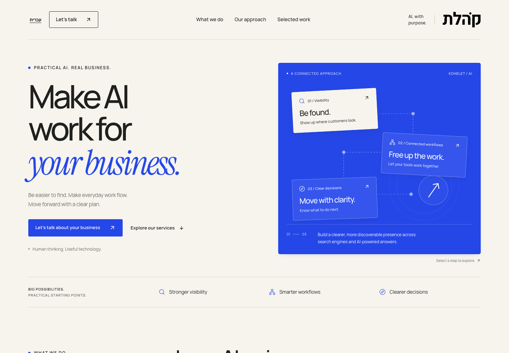

# Kohelet landing verification

Issue #2 · branch `agent/codex/2-codex-landing` · 2026-10-20

Local production-build preview: http://127.0.0.1:3103/codex-landing

## Implemented

English page at `/codex-landing` and complete Hebrew counterpart at `/he/codex-landing`, with an interactive service map, three service narratives, process, two existing portfolio examples, native FAQ, and accessible contact form. Kohelet assets are reused. Scoped CSS preserves the other root layouts. The existing email endpoint now validates input and checks provider acceptance rather than reporting rejected sends as success.

## Checks

- `npm run build`: pass, including TypeScript and static generation of `/codex-landing` (installed Next.js 16.1.4).
- `node --test scripts/test-contact.cjs`: 4 passing tests covering acceptance, rejection/missing receipt, invalid input, and configuration/provider exceptions. Injected provider, no real email.
- Focused ESLint: pass for `app/codex-landing`, `app/api/contact/route.ts`, and `middleware.ts`, using the installed Next native flat exports in a temporary config. The repository's `npm run lint` fails before examining files because its pre-existing FlatCompat setup produces a circular React config error; tracked in issue #3. No global tooling change included.
- Six contact browser scenarios pass: required/email/whitespace validation, actual unconfigured endpoint failure, malformed success response, pending/duplicate protection/accepted reset, HTTP failure, and network failure. Success/error network responses were intercepted, except the local no-credentials error. Fields are retained on failure. See [results](contact-results.json).
- Production-build browser checks: no overflow at 320, 390, 768, 1440 pixels; exact URL with no locale redirect; valid internal anchors and metadata; no page errors. Automated axe WCAG 2 A/AA and 2.1 AA scan of `.kl-page` returned no violations. See [layout results](layout-results.json).
- Desktop and iPhone 13 Chromium emulation: service map selection by pointer and keyboard, immediate keyboard state changes, FAQ Enter toggle, contact anchor, skip-link focus, and stable reduced-motion hover all pass. `/en`, `/he`, `/777`, and `/codex-landing` return HTTP 200 without redirects. See [interaction results](interaction-results.json). Emulation does not establish physical-device or VoiceOver behavior.
- Header follow-up: Hebrew logo is aligned to the far right, with the contact CTA on the left. Verified at 320/390/768/1440px, without overflow; see [header results](header-results.json). Build and focused lint pass. Screenshots updated and the existing in-app preview refreshed.

The browser harnesses used transient Playwright and axe tooling outside the repository. Screenshots below were taken against the local production build, after scrolling to load and decode the existing project images.

## Complete Hebrew version

- `/he/codex-landing` uses the existing Hebrew root layout and Heebo font, with translated navigation, hero, service map, services, process, project captions/alt text, FAQ, footer, and form labels/placeholders/validation/pending/success/error messages.
- Language links stay visible on mobile and navigate between the Hebrew route and exact English `/codex-landing`. English locale-prefixed duplicate redirects to the canonical English route.
- RTL mirrors layout and directional icons while keeping the Hebrew logo at the physical right. Email addresses and domains remain LTR. Canonical URLs, hreflang, Open Graph/Twitter text, and sitemap language alternates are localized.
- Production-build checks pass at 320/390/768/1440px: no overflow, logo on right, language round trip, diagram selection, FAQ keyboard interaction. Desktop and mobile automated WCAG scans report zero violations; zero browser page errors. Hebrew native required/email messages, pending, accepted/reset, real missing-credentials error, input retention, and reduced motion pass. All six original English contact scenarios also pass. See [Hebrew results](hebrew-results.json).
- Remaining legacy Hebrew blog/UI translations are handled separately in issue #8, stacked on this landing work.

[Hebrew desktop](hebrew-desktop.png) · [Hebrew mobile](hebrew-mobile.png)

## Emil Kowalski animation review

Applied the official [design engineering](https://github.com/emilkowalski/skills/tree/main/skills/emil-design-eng), [animate](https://github.com/emilkowalski/skills/tree/main/skills/animate), and [review-animations](https://github.com/emilkowalski/skills/tree/main/skills/review-animations) skills. The initial stagger explains the marketing page hierarchy; hover and press feedback confirm interactions. No repeated or automatic motion.

| Before | After | Why |
| --- | --- | --- |
| Animated node shadow | Static selected shadow | Avoid painting shadows during movement. |
| Project hover at 350ms | 220ms transform transition | Keep UI feedback within the animation budget. |
| Reduced motion stopped durations but changed transforms | Interactive movement gated by motion preference and fine pointer | Preserve resting rotations without snapped hover movement. |
| Keyboard map selection transitioned | Immediate state change when focus-visible | Keep keyboard interaction immediate. |

Review verdict after fixes: **Approve**. Browser verification confirms keyboard and reduced-motion behavior.

## Limits and release status

Local provider credentials were not copied. The actual contact endpoint returns `Email service not configured` in this preview and the form shows a recoverable error. Provider acceptance is tested with an injected provider; inbox delivery remains unverified. Production requires its existing valid email configuration. No real email, production deployment, or merge was performed. PR remains draft because the repository lint command is blocked by #3.

## Screenshots

[Full desktop page](desktop.png) · [Full mobile page](mobile.png) · [iPhone emulation viewport](mobile-hero.png)
